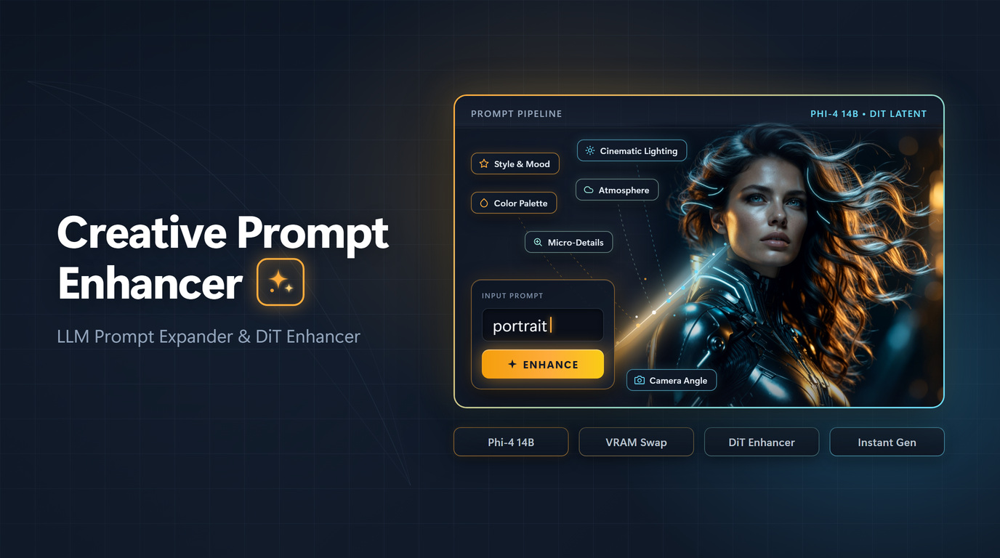

# Creative Prompt Enhancer for SD WebUI Forge / Forge NEO

  <a href="#english">English</a> • <a href="#русский">Русский</a>

---

## English

An extension for **Forge NEO** that transforms simple short prompts (in Russian or English) into creative, cinematic, deep, and visually rich prompts.

### ✨ Key Features

1. **"Enhance" Button** — Creatively expands your idea directly in the prompt box: describes the hero subject, angle/framing, micro-details, cinematic lighting, color, and composition.
2. **Dual Text Enhancement Modes**:
   - **Phi-4 (14B, 4-bit) (Default)**: Featuring a compact architecture of just 14B parameters, Phi-4 performs on par with much larger giants thanks to deep pre-training on curated academic literature and high-quality books. This enables it to build intricate reasoning chains to craft deep, imaginative prompts. Operates via a smart VRAM swap mechanism: Forge's active model is temporarily unloaded from VRAM during text generation and restored immediately afterward.
     > 💡 **On-Demand Auto-Download**:
     > Nothing is downloaded in advance when Forge starts. The Phi-4 model will begin downloading automatically only upon the first click of the **"Enhance"** button. Weights are saved to `models/text_encoder/Phi-4-bnb-4bit`. If the folder does not exist, the script creates it automatically.
   - **Use Model Text Encoder**: Enhances prompts using the active Forge preset's native text encoder (**Krea 2**, **Qwen 2.1**, **MOSS Image**, etc.).
     > ⚠️ **Important Notes**:
     > - **MOSS Image**: Due to encoder and Forge architecture specifics, token generation runs on the **CPU** with heavy CPU load *(use at your own discretion)*.
     > - **Quantizations**: Tested on primary standard models; custom quantizations (`nvfp4`, `w4a8`) or other encoders were not extensively tested and might produce varied results or errors.
     > - **Auto-Fallback**: If the active preset text encoder does not support text generation (e.g. T5, CLIP, or Embedding-Only encoders like MiniMax H3 / Qwen3-VL 32B), the script automatically switches to **Phi-4** *(check console logs)*.
3. **Enable Generation Enhancement**:
   - Built-in hardware DiT latent enhancement for **Krea 2**, **Qwen 2.1**, and **MOSS Image** (not tested on other architectures).
   - Enhances micro-contrast, sharpness, and generation structure on complex prompts; particularly effective on **Krea 2** due to its lighter text encoder.
4. **Instant generation** *(toggle)*:
   - Automatic generation right after prompt enhancement.
   - As soon as the model (Phi-4 or preset encoder) finishes enhancing the prompt and restores Forge's native text encoder back into VRAM, the enhanced prompt is automatically applied to the main prompt box, the page smoothly scrolls back to the top, and image generation starts automatically.
5. **"Apply to Main Prompt" Button** — Copies the enhanced prompt into the main generation prompt box and smoothly scrolls the page back up to the prompt.
6. **Progress Indicator** — Clear, real-time terminal token percentage progress bar.

### 🚀 Installation

1. Open **SD WebUI Forge**.
2. Go to **Extensions** → **Install from URL**.
3. Paste this repository's URL into **URL for extension's git repository**.
4. Click **Install**.
5. Go to the **Installed** tab and click **Apply and restart UI**.

---

## Русский

Расширение для **Forge NEO**, преобразующее простые короткие запросы (на русском или английском) в креативные, кинематографичные, глубокие и визуально богатые промпты.

### ✨ Основные функции

1. **Кнопка «Enhance»** — Креативно расширяет вашу идею в окне промпта: описывает главного героя, ракурс, микродетали, кинематографичный свет, цвет и композицию.
2. **Два режима улучшения текста**:
   - **Phi-4 (14B, 4-bit) (по умолчанию)**: Обладая компактной архитектурой всего на 14B параметров, модель Phi-4 работает на уровне гораздо более емких гигантов благодаря глубинному обучению на выверенной академической литературе и книгах, что позволяет ей выстраивать сложные логические цепочки для создания глубоких и креативных промптов. Работает по принципу умного свопа: на время генерации текста родная модель Forge временно выгружается из VRAM, а после генерации возвращается обратно.
     > 💡 **Загрузка модели (On-Demand)**:
     > При первом запуске Forge ничего заранее скачиваться не будет. Модель Phi-4 загружается автоматически только при первом её вызове (нажатии кнопки **«Enhance»**). Файлы сохраняются в папку `models/text_encoder/Phi-4-bnb-4bit`. Если такой папки нет, скрипт создаст её автоматически.
   - **Use Model Text Encoder**: Улучшение промпта силами родного энкодера активного пресета Forge (**Krea 2**, **Qwen 2.1**, **MOSS Image** и др.).
     > ⚠️ **Важные нюансы**:
     > - **MOSS Image**: из-за специфики энкодера **Qwen3.5_9B** генерация выполняется через **CPU** с высокой нагрузкой на процессор *(используйте на свой страх и риск)*.
     > - **Квантования**: тесты проводились на **int8_convrot**; на других квантованиях (`nvfp4`, `w4a8`) или сторонних энкодерах возможны отличия в результатах или сбои.
     > - **Авто-переключение (fallback)**: если у выбранного пресета энкодер не поддерживает генерацию текста (например, T5, CLIP или Embedding-Only энкодеры вроде MiniMax H3 / Qwen3-VL 32B), скрипт автоматически переключится на **Phi-4** *(следите за информацией в консоли)*.
3. **Enable Generation Enhancement**:
   - Встроенное аппаратное улучшение скрытых латентов DiT для моделей **Krea 2**, **Qwen 2.1** и **MOSS Image**, на других моделях не тестировалось.
   - Повышает микроконтраст, резкость и структуру генерации при сложных промптах, лучше всего работает на **Krea 2** из-за ее слабого текстового энкодера.
4. **Instant generation** *(тумблер)*:
   - Автоматическая генерация сразу после написания промпта.
   - Как только модель (Phi-4 или энкодер пресета) завершит улучшение промпта и вернёт оригинальный энкодер в память, улучшенный промпт автоматически подставится в главное поле, страница плавно вернётся наверх и сразу запустится генерация.
5. **Кнопка «Apply to Main Prompt»** — переносит готовый улучшенный промпт в главное окно генерации и плавно прокручивает страницу наверх к промпту.
6. **Индикатор прогресса** — наглядная процентная шкала токенов в консоли в реальном времени.

### 🚀 Установка

1. Откройте **SD WebUI Forge**.
2. Перейдите во вкладку **Extensions** → **Install from URL**.
3. Вставьте URL этого репозитория в поле **URL for extension's git repository**.
4. Нажмите кнопку **Install**.
5. Перейдите во вкладку **Installed**, нажмите **Apply and restart UI**.

---
**Author:** Cj
